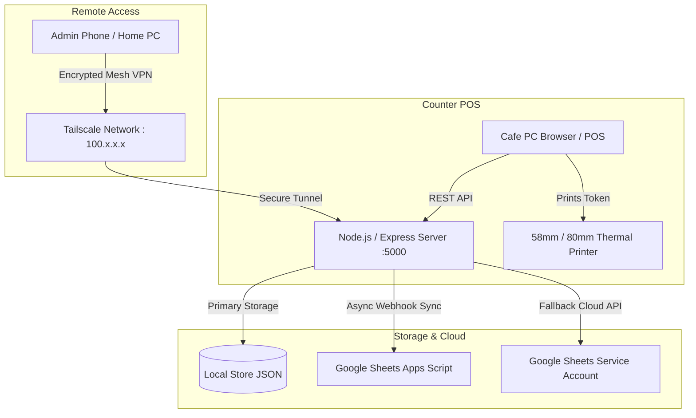

# 🎮 Twin Spin Gaming Arcade Cafe — Management & POS Billing Suite

An enterprise-ready, offline-first billing, queue management, live hardware token printing, and remote administrative control system built for arcade gaming centers, cafes, and amusement zones.

---

## 📑 Table of Contents
1. [Key Features & Capabilities](#-key-features--capabilities)
2. [Architecture Overview](#-architecture-overview)
3. [Remote Access via Tailscale (Admin From Home/Phone)](#-remote-access-via-tailscale-admin-from-homephone)
4. [Domino's Style Automated Discount Scheduling](#-dominos-style-automated-discount-scheduling)
5. [Thermal Token Printing & Cash Drawer Register Tally](#-thermal-token-printing--cash-drawer-register-tally)
6. [Offline Resilience & Auto-Sync](#-offline-resilience--auto-sync)
7. [Security & Role-Based Access Control](#-security--role-based-access-control)
8. [Installation & Setup Guide](#-installation--setup-guide)
9. [Default Login Credentials](#-default-login-credentials)
10. [Google Sheets Cloud Webhook Integration](#-google-sheets-cloud-webhook-integration)

---

## 🌟 Key Features & Capabilities

### 1. Counter POS Billing (Cashier Mode)
- **Fast Touch & Click Grid**: High-contrast visual game cards with real-time station availability.
- **Dynamic Multi-Person Stepper**: Per-person pricing calculation with live reactive subtotals.
- **Domino's-Style Auto-Apply**: Active promotional discounts automatically detect cart items and apply without cashier intervention.
- **Dual Payment Support**: Cash and UPI payments with customer QR code display.
- **Live Cashier Offer Banner**: Flashing alert banner at the top of the billing screen notifying staff of active store promotions in real time.

### 2. Physical Station Queue Management
- **FIFO Waiting Queue**: Manages queues for single or multi-station attractions (Bowling, Bike Racing, Boxing, VR, etc.).
- **Live Session Timers**: Displays playing customers, elapsed time, and station occupancy.
- **Auto-Promotion**: Automatically moves the next waiting customer into "Playing" status when a session concludes.

### 3. Remote Owner & Admin Control
- **100% Mobile-Responsive**: Beautiful administrative dashboard tailored for smartphones and tablets.
- **Live Real-Time KPIs**: Total daily revenue, cash vs UPI breakdown, ticket volume, customer footfall, and attraction-by-attraction performance.
- **Full Catalog Control**: Real-time price editing, game toggling (soft delete), and station count adjustment.
- **Discount & Happy Hours Engine**: Schedule offers by date range, specific days of the week, and exact time windows.
- **Audit Logs & Ticket Management**: Search, edit customer details, or delete bookings with administrative authority.

---

## 🏗️ Architecture Overview



---

## 🌐 Remote Access via Tailscale (Admin From Home/Phone)

Tailscale provides a **zero-config, encrypted WireGuard mesh VPN** that assigns a **permanent private IP address** (e.g., `100.95.146.84`) to the cafe computer. This allows the arcade owner to monitor live sales, change prices, and manage tickets from their mobile phone anywhere in the world without exposing ports to the public internet.

### Why Tailscale?
- **No Dynamic IP Issues**: Unlike standard ISP IPs or temporary tunnels (like Ngrok), Tailscale's IP **never changes** when the PC restarts or re-connects.
- **End-to-End Encryption**: Secure WireGuard protocol ensures only authenticated devices on the owner's account can reach the POS server.
- **Zero Firewall Hassle**: Bypasses CGNAT and residential routers without port forwarding.

### Setup Steps:
1. **On the Cafe PC**:
   - Download and install Tailscale from [tailscale.com](https://tailscale.com).
   - Sign in with your Google or Microsoft account.
   - Note the assigned 100.x.x.x IP address (e.g., `100.95.146.84`).
2. **On the Owner's Smartphone**:
   - Install the **Tailscale** app from the App Store or Google Play Store.
   - Sign in using the **same account**.
   - Turn the VPN switch **ON**.
3. **Accessing the Dashboard**:
   - Open Safari or Chrome on your phone and browse to:
     ```
     http://100.95.146.84:5000
     ```
   - Log in with `admin` / `admin123`.
   - *Tip*: Tap **"Add to Home Screen"** in your phone's browser to use it like a native mobile app!

---

## ⏰ Domino's Style Automated Discount Scheduling

The discount engine allows arcade owners to create intelligent promotional campaigns matching modern restaurant chains:

### Configuration Options:
- **Time Windows (Happy Hours)**: Define start and end times (e.g., `14:00` to `18:00` for 2 PM - 6 PM). Supports both daytime and overnight schedules (e.g., `22:00` to `02:00`).
- **Days of Week**: Apply offers daily, weekdays only (Mon-Fri), weekends only (Sat-Sun), or custom alternate days (e.g., Mon, Wed, Fri).
- **Date Validity**: Optional calendar start and end dates.
- **Benefit Type**: Percentage deduction (e.g., `20% OFF`) or Flat amount deduction (e.g., `₹50 FLAT OFF`).
- **Scope**: Apply cafe-wide (all games) or restricted to specific attractions.
- **Auto-Apply Feature**: Automatically applies the discount to matching game items the moment they are selected at the counter during the active schedule.

### Real-Time IST Enforcement:
All time and date checks are strictly synchronized to **Indian Standard Time (`Asia/Kolkata`)**, preventing midnight UTC rollover discrepancies.

---

## 🖨️ Thermal Token Printing & Cash Drawer Register Tally

### 1. Customer Token Receipts (58mm / 80mm ESC/POS)
Generates compact, high-contrast receipts formatted specifically for thermal roll printers:
- Arcade branding, address, and contact details
- Token ID & timestamp in IST
- Itemized games list with player multiplier and unit price
- Original MRP Subtotal
- Promotional discount name and exact amount deducted
- **★ YOU SAVED** customer highlight badge
- Final amount paid and payment mode (Cash / UPI)
- Custom footer terms (e.g., non-refundable tokens)

### 2. Day Register Drawer Summary (End-of-Day Closing)
Cashiers or managers can print a specialized register closure slip from the **Tickets History** tab to tally the cash drawer:
- Total bookings count
- Total physical cash in drawer
- Total online UPI receipts
- Grand total collections
- Cashier & manager signature line

---

## ⚡ Offline Resilience & Auto-Sync

Internet outages at the arcade counter will never stop business:
- **Instant Local Caching**: Product catalogs and pricing are cached locally.
- **Offline Ticket Generation**: If the connection drops, tickets receive a unique offline identifier (`TK-OFF-XXXX`) and print immediately.
- **Automatic Queue Sync**: As soon as internet connectivity is restored, queued offline bookings are silently synchronized to the server and Google Sheets.
- **Background Retry Worker**: The server runs an automatic synchronization retry cycle every 3 minutes to guarantee all paid bookings reach Google Sheets.

---

## 🔒 Security & Role-Based Access Control

1. **Password Encryption**: All passwords are cryptographically hashed using **bcrypt** (salt factor 10). Plaintext passwords are never stored.
2. **JWT Authentication**: Secure JSON Web Tokens with strict expiration.
3. **API Access Control**: Endpoints modifying settings, users, games, and discounts enforce `requireRole('admin')`. Billing operators cannot access admin endpoints (HTTP 403 Forbidden).
4. **Data Sanitization**: User listings strictly omit password hashes from all API responses.
5. **Rate Limiting**: Brute-force protection limits failed login attempts (max 10 attempts per 15 minutes per IP).

---

## 🚀 Installation & Setup Guide

### Option A: 1-Click Batch Runner (Windows)
1. Double-click `run-arcade.bat` inside the project root folder.
2. The script will automatically:
   - Terminate any dangling processes on port 5000
   - Install dependencies if running for the first time
   - Start the backend server
   - Launch `http://localhost:5000` in your default browser

### Option B: Manual Setup via Terminal
```bash
# 1. Clone or extract repository
git clone https://github.com/YantrikMinds/twin-spin-arcade.git
cd twin-spin-arcade

# 2. Setup Server
cd server
npm install

# 3. Start Application
node server.js
```

Open your browser to: **`http://localhost:5000`**

---

## 🔑 Default Login Credentials

| Role | Username | Password | Access Capabilities |
|---|---|---|---|
| **Admin (Owner)** | `admin` | `admin123` | Full control, revenue dashboard, game pricing, discount rules, system settings |
| **Billing Staff** | `counter1` | `staff123` | Counter POS billing, customer token issuance, queue station controls |

> ⚠️ **Important**: Change the default admin password from the **Admin -> Users** tab before going into production!

---

## 📊 Google Sheets Cloud Webhook Integration

In addition to the local JSON database, Twin Spin can log every ticket live into a Google Sheet via Google Apps Script:

1. Open your Google Sheet.
2. Navigate to **Extensions > Apps Script**.
3. Paste the provided webhook script and click **Deploy > New Deployment**.
4. Select **Web App**, set access to **"Anyone"**, and copy the generated Webhook URL.
5. In the Twin Spin Admin panel, go to **Settings** and paste the Webhook URL into the **Google Sheet Webhook URL** field.
6. Click **"Test Connection"** to verify real-time syncing!

---

## 🛠️ Tech Stack
- **Frontend**: React 18, Tailwind CSS, Lucide Icons, Vite
- **Backend**: Node.js, Express, Helmet, CORS, bcryptjs, jsonwebtoken, express-rate-limit
- **Networking**: Tailscale Mesh VPN
- **Storage**: Multi-tier engine (Local JSON Store + Google Sheets Webhook)

---

## 📄 License
MIT License. Built for Twin Spin Gaming Arcade Cafe.
